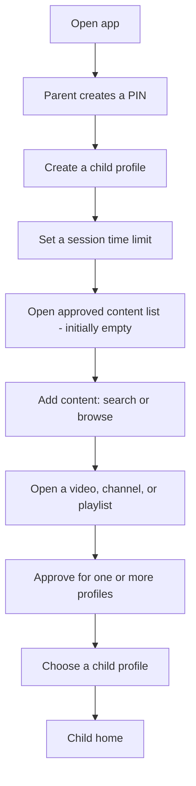
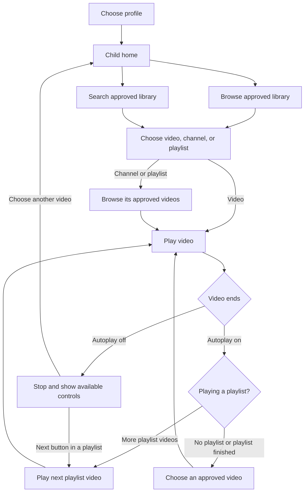
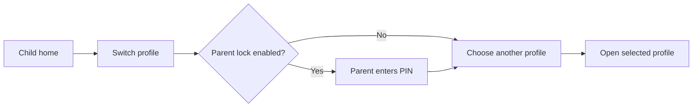
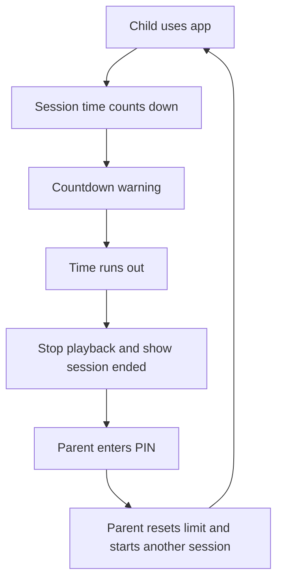
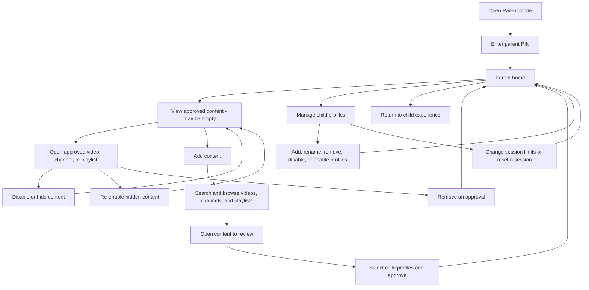

# NewPipe Kids: user flow

This flow shows the main paths for children and parents. The rules behind it
are described in [CONCEPT.md](CONCEPT.md).

## First-time setup

When a parent approves a channel or playlist, the app explains that future
uploads or additions will also be available. The parent can add more content
and profiles later in Parent mode.

## Child: find and watch a video

- The child can turn autoplay on or off.
- Search can match approved videos, channels, and playlists. A child can also
  view favorites; hidden or disabled content stays out of those views.
- Outside a playlist, autoplay prefers unwatched approved videos. Once all
  approved videos have been watched, it chooses the one whose most recent
  viewing was longest ago. A video counts as watched after 90% has played.
- If a video is unavailable, the app shows a simple message and the child can
  choose another approved video. Autoplay skips unavailable videos.
- Search, related content, playlist playback, and links only open content
  approved for the active profile.

## Child: switch profiles

Each profile keeps its own session time. Returning to a profile resumes its
existing session; switching profiles does not reset it. Disabled profiles are
hidden from children and can be re-enabled in Parent mode.

## Session time limit

Time counts while the child actively uses the app, including browsing and
playback, and pauses when the app is backgrounded. Only a parent can start
another session after the limit is reached. Parents can set the session limit
from 1 minute to 2 hours. There is no daily limit for now; parents decide
whether to start another session. The warning appears for the last 10% of a
session, with a minimum of 10 seconds and a maximum of one minute.

## Parent: manage content and settings

In Add content, parents choose YouTube, PeerTube, or media.ccc.de. For
PeerTube, they can choose the server to search. The parent reviews an item and
selects the profiles that should receive it.

Removing an approval removes access only when no other approval covers the
video. If the app detects that a currently playing video is no longer covered,
it stops playback. Approved channels and playlists refresh when the app opens
and periodically while in use; if a refresh fails, the last known library is
used.

Disabling or hiding an approval keeps it in the parent's approved content list
but makes that content unavailable to the child until it is re-enabled.
An explicitly hidden video stays unavailable even if an approved channel or
playlist also includes it. When refresh is unavailable, the app still applies
local approval removals and hidden content to the last known library. After the
session, the parent can update the configuration or restore internet access.
